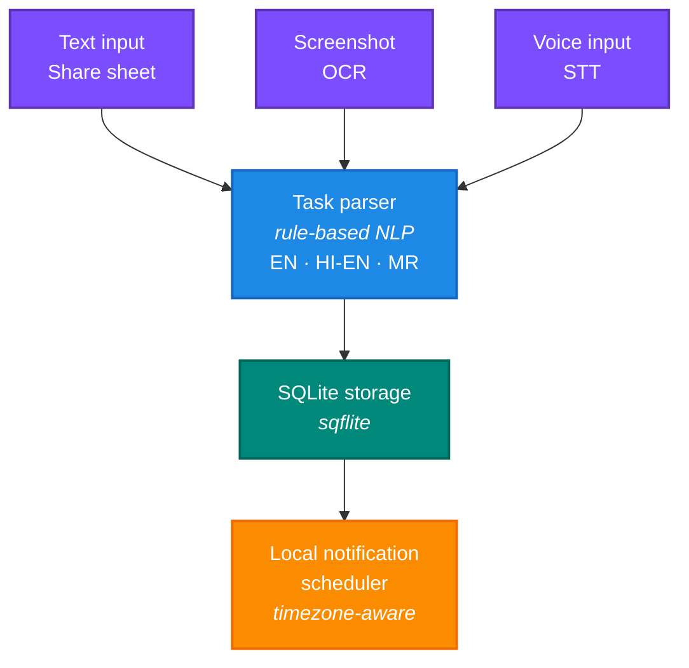
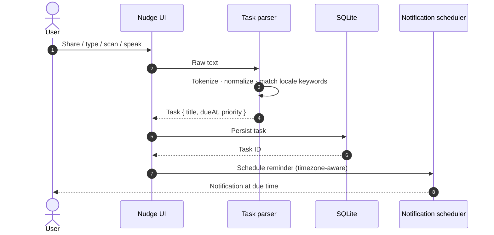

# Nudge 🔔
> Never miss a deadline again.

Nudge is a smart task manager built for students. Share a WhatsApp message, paste text, or type it yourself — Nudge extracts the task, figures out the deadline, and keeps you on track.

Built for how students actually communicate. Plain English, Hinglish, Marathi — vague deadlines and all.

---

<!-- SECONDARY BADGES -->
<p>
  <a href="LICENSE"></a>
  
  
  
  
  
</p>

Academic deadlines arrive from everywhere — WhatsApp groups, Google Classroom, college portals, verbal announcements. It's unstructured, scattered, and easy to forget. Assignments get missed. Submissions happen at 11:59 PM.

<!-- NAVIGATION -->
<p>
  <a href="#-demo"><b>Demo</b></a>
  &nbsp;·&nbsp;
  <a href="#-features"><b>Features</b></a>
  &nbsp;·&nbsp;
  <a href="#-tech-stack"><b>Tech stack</b></a>
  &nbsp;·&nbsp;
  <a href="#-how-it-works"><b>How it works</b></a>
  &nbsp;·&nbsp;
  <a href="#-screenshots"><b>Screenshots</b></a>
  &nbsp;·&nbsp;
  <a href="#-getting-started"><b>Get started</b></a>
  &nbsp;·&nbsp;
  <a href="#-roadmap"><b>Roadmap</b></a>
</p>

Share any message directly to Nudge. It reads the text, extracts the task, resolves the deadline — and saves it. No copy-pasting. No manual formatting. Just tap Share → Nudge → Save.

---

<br />

- **Share to App** — share text from WhatsApp, Classroom, Notes directly into Nudge
- **Smart Parser** — extracts task name and deadline from natural language
- **Hinglish + Marathi support**
  - `"kal submit karna hai"` → Due: Tomorrow
  - `"udya report dena ahe"` → Due: Tomorrow
  - `"submit by next Monday"` → Due: Next Monday
  - `"3 din mein assignment"` → Due: In 3 days
- **Offline-first** — works without internet, always
- **Local SQLite storage** — your data stays on your device
- **Clean minimal UI** — built for speed, not clutter

---

<br />

<!-- ============================================================ -->
<!--                            DEMO                              -->
<!-- ============================================================ -->

<h2 align="center">
  
</h2>

<p align="center"><i>A 30-second walkthrough: paste, parse, get reminded.</i></p>

<div align="center">

<!-- Replace with: docs/media/demo.gif -->


<!-- Click-through video alternative
<a href="docs/media/demo.mp4">
  
</a>
-->

</div>

<br />

<!-- ============================================================ -->
<!--                         WHY NUDGE                            -->
<!-- ============================================================ -->

<h2 align="center">
  
</h2>

<table>
<tr>
<td width="55%" valign="top">

<br />

Students live inside group chats, PDFs, and screenshots. Deadlines hide in casual messages -

> *"kal submit karna hai"*
> *"udya report dena ahe"*
> *"reminder, viva on Friday 4pm"*

Most task apps make you stop, switch context, and **type it all in again**.

Nudge reads that noise the way a friend would, and quietly turns it into a task with a reminder. Forward a message. Share a screenshot. Speak a sentence. That's it.

</td>
<td width="45%" valign="top">

<!-- Replace with: docs/media/why-illustration.png -->


</td>
</tr>
</table>

<br />

<!-- ============================================================ -->
<!--                          FEATURES                            -->
<!-- ============================================================ -->

<h2 align="center">
  
</h2>

<table>
  <tr>
    <td align="center" width="33%" valign="top">
      <br />
      
      <h3>Smart parser</h3>
      <p>Understands English, Hinglish, and Marathi (English script). Extracts dates, times, and priorities from natural sentences.</p>
    </td>
    <td align="center" width="33%" valign="top">
      <br />
      
      <h3>Share intent</h3>
      <p>Receive text or files from any app via the Android share sheet - instant, friction-free task creation.</p>
    </td>
    <td align="center" width="33%" valign="top">
      <br />
      
      <h3>OCR import</h3>
      <p>Pull deadlines straight from screenshots, posters, and notice boards using Google ML Kit.</p>
    </td>
  </tr>
  <tr>
    <td align="center" width="33%" valign="top">
      <br />
      
      <h3>Voice input</h3>
      <p>Dictate tasks hands-free with on-device speech-to-text. Perfect for the walk between classes.</p>
    </td>
    <td align="center" width="33%" valign="top">
      <br />
      
      <h3>Calendar view</h3>
      <p>See deadlines laid out by day with priority-aware highlighting and quick reschedule.</p>
    </td>
    <td align="center" width="33%" valign="top">
      <br />
      
      <h3>Local reminders</h3>
      <p>Timezone-aware notifications scheduled on-device. No server, no missed pings.</p>
    </td>
  </tr>
  <tr>
    <td align="center" width="33%" valign="top">
      <br />
      
      <h3>Offline-first</h3>
      <p>SQLite-backed local storage. Works on a flight, in a basement, anywhere.</p>
    </td>
    <td align="center" width="33%" valign="top">
      <br />
      
      <h3>Material 3</h3>
      <p>Modern, expressive UI with full dark-mode support and Google Fonts typography.</p>
    </td>
    <td align="center" width="33%" valign="top">
      <br />
      
      <h3>Privacy by default</h3>
      <p>No account, no analytics, no data leaves the device. Period.</p>
    </td>
  </tr>
</table>

<br />

<!-- ============================================================ -->
<!--                         TECH STACK                           -->
<!-- ============================================================ -->

<h2 align="center">
  
</h2>

<div align="center">

<a href="https://skillicons.dev">
  
</a>

<br /><br />

<table>
  <tr>
    <th align="left">Layer</th>
    <th align="left">Technology</th>
  </tr>
  <tr>
    <td>Framework</td>
    <td><b>Flutter</b> &nbsp; <code>3.x</code> &nbsp;·&nbsp; <b>Dart</b> &nbsp; <code>3.x</code></td>
  </tr>
  <tr>
    <td>Local database</td>
    <td><b>SQLite</b> via <code>sqflite</code></td>
  </tr>
  <tr>
    <td>OCR</td>
    <td><b>Google ML Kit</b> Text Recognition</td>
  </tr>
  <tr>
    <td>Speech-to-text</td>
    <td><code>speech_to_text</code> (on-device)</td>
  </tr>
  <tr>
    <td>NLP parsing</td>
    <td>Custom rule-based parser - EN / Hinglish / Marathi</td>
  </tr>
  <tr>
    <td>Notifications</td>
    <td><code>flutter_local_notifications</code> + <code>timezone</code></td>
  </tr>
  <tr>
    <td>Theming</td>
    <td><b>Material 3</b> + Google Fonts</td>
  </tr>
  <tr>
    <td>Platform</td>
    <td>Android (iOS/macOS/web/windows/linux scaffolding included)</td>
  </tr>
</table>

</div>

<br />

<!-- ============================================================ -->
<!--                       HOW IT WORKS                           -->
<!-- ============================================================ -->

<h2 align="center">
  
</h2>

<p align="center"><i>From a casual message to a scheduled reminder, in three quiet steps.</i></p>



### Pipeline detail



### Examples

<div align="center">

| You write | Nudge schedules |
|---|---|
| Framework | Flutter (Dart) |
| Local Database | SQLite via `sqflite` |
| NLP Parser | Rule-based with Hinglish/Marathi support |
| Share Integration | Android native intent (`ACTION_SEND`) |
| Platform | Android (iOS ready) |

---

## Roadmap

- [x] Phase 1 — Project setup and local SQLite storage
- [x] Phase 2 — Manual task input with deadline picker
- [x] Phase 3 — Share intent from WhatsApp, Classroom, Notes
- [x] Phase 4 — Hinglish + Marathi parser and date resolver
- [ ] Phase 5 — OCR from screenshots
- [ ] Phase 6 — Local push notifications
- [ ] Phase 7 — Cloud sync (optional)

---

## Getting Started

### Prerequisites
- Flutter SDK 3.x or above
- Android Studio with Android SDK
- Android device or emulator (API 21+)

```bash
git clone https://github.com/sahiljo14/nudge-app.git
cd nudge-app

# 2. Fetch dependencies
flutter pub get

# 3. Sanity-check
flutter analyze
flutter test

# 4. Run on a connected device or emulator
flutter run
```

### Test Share Intent (via ADB)
```bash
adb shell am start \
  -a android.intent.action.SEND \
  -t text/plain \
  --es android.intent.extra.TEXT "kal tak DSA assignment submit karna hai" \
  com.nudgeapp.nudge/.MainActivity
```

---

## Project Structure
```
nudge-app/
├── android/
│   └── app/src/main/
│       ├── kotlin/com/nudgeapp/nudge/
│       │   └── MainActivity.kt        # Share intent handler
│       └── AndroidManifest.xml        # Intent filters
├── lib/
│   ├── database/
│   │   └── db_helper.dart             # SQLite CRUD
│   ├── models/
│   │   └── task.dart                  # Task model
│   ├── parser/
│   │   ├── date_resolver.dart         # Natural language date parser
│   │   ├── rule_parser.dart           # Task + deadline extractor
│   │   └── share_handler.dart         # Platform channel for share intent
│   ├── screens/
│   │   ├── home_screen.dart           # Task list
│   │   └── add_task_screen.dart       # Add/parse task
│   ├── widgets/
│   │   └── task_card.dart             # Task UI component
│   └── main.dart                      # App entry + share intent router
└── pubspec.yaml
```

---

## License

<br /><br />

<a href="#nudge"></a>

*Built by students, for students.*
